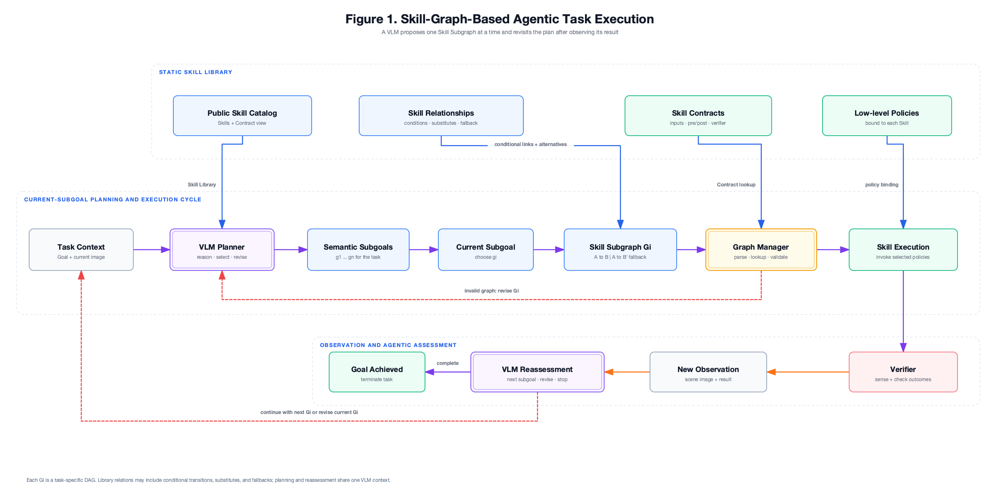
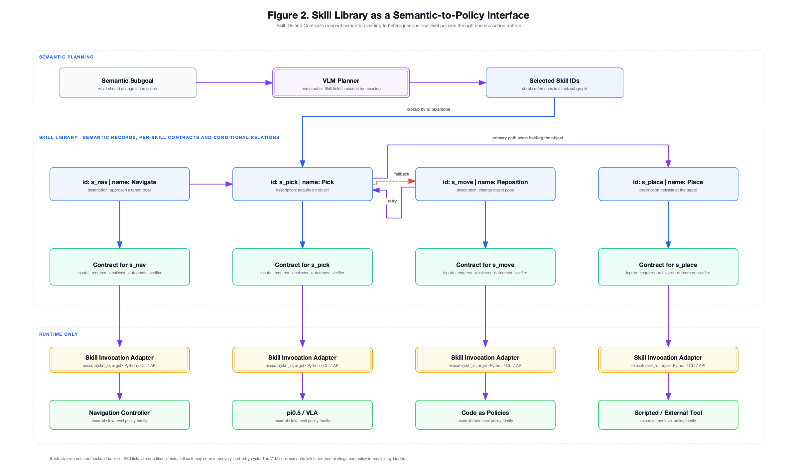

# Graph Manager

Graph Manager focuses on task-conditioned skill graphs and the VLM interface around them. It uses visual observations, a user's task, and a skill library to propose semantic subgoals and a skill subgraph for each subgoal. This repository defines how those outputs are represented, parsed, and checked against existing skill contracts, and executes them against the ZenoBench environment service. The robot skills and benchmark scenes are maintained by collaborators in the same project.

## Architecture

These figures show the architecture. `graph-manager-plan` produces all Subgoals and Skill Subgraphs in one model response. `graph-manager-run` executes one Subgoal at a time and lets the model continue, replan, or finish after each one (see Closed-loop runs). Conditional links and fallback in Figure 2 are not implemented yet.

[](docs/diagrams/graph-manager-figure1.svg)

*Figure 1. A VLM plans semantic Subgoals, proposes a Skill Subgraph for the current Subgoal, and uses observations after execution to decide what to do next.*

[](docs/diagrams/graph-manager-figure2.svg)

*Figure 2. Skill IDs, descriptions, Contracts, conditional links, and fallback connect semantic planning to a uniform invocation interface. The policy families shown are illustrative backend examples, not current ZenoBench integrations.*

## Skill Library

Skills come from [ZenoBench](https://github.com/CMU-Agentic-Library/ZenoBench), which provides the underlying robot skills and the environment service. Graph Manager keeps no skill definitions of its own. `scripts/sync_zenobench.py` copies `skill_library/skills/*/{SKILL.md,skill.json}` and `tasks.json` from a local ZenoBench checkout into `graph_manager/vendor/zenobench/` and records the commit in `COMMIT`. The 35 reference subgraphs from `skill_library/plans/` go to `tests/fixtures/zenobench_plans/` and are used only as test data.

```bash
git -C ../ZenoBench checkout <commit>
.venv/bin/python scripts/sync_zenobench.py ../ZenoBench
```

The model sees the skills through DeepSeek Harness's skill loader: the catalog lists each skill's `name` and `description`, and the model loads a full `SKILL.md` when it needs one. The validator reads the matching `skill.json` files.

## Planning

Graph Manager accepts a Goal, an optional scene image, and optional observation text. One model response proposes all Subgoals and one ZenoBench schema 2 skill subgraph for each Subgoal:

```json
{
  "schema_version": 2,
  "kind": "task_plan",
  "subgoals": [{"id": "sg_1", "goal": "Hold the apple"}],
  "subgraphs": [{
    "schema_version": 2,
    "kind": "skill_subgraph",
    "subgoal_id": "sg_1",
    "nodes": [{"id": "n1", "skill": "pick", "args": {"object": {"ref": "apple"}}, "depends_on": []}]
  }]
}
```

An argument is `{"ref": scene name}`, `{"value": literal}`, or `{"from": "<node>.<output>"}` for a measured output of an ancestor node in the same subgraph. The validator applies the rules of ZenoBench `skill_library/graph.py` (skill verb, required and allowed inputs, value types, `from` references, DAG) and reports every issue with a JSON path, such as `$.subgraphs[0].nodes[0].skill`. It does not check whether a scene name exists or whether preconditions hold; the environment decides both. Rejected proposals receive the issues as feedback in the same Harness session.

### Install and run

```bash
uv sync --locked --extra dev
.venv/bin/python -m unittest discover -s tests
.venv/bin/ruff check .
.venv/bin/ruff format --check .
```

Skill loading is a tool call, so the served model must support tool calling (for vLLM, `--enable-auto-tool-choice` with the model's `--tool-call-parser`). `examples/vllm-qwen3.5-4b.compose.yml` serves Qwen3.5-4B this way on port 8001 as `qwen3.5-4b`, and `examples/harness-local-vlm.patch.yml` points Harness at that server. For another model, edit the patch's `baseURL` and model ID; `--model` must match the model ID.

```bash
mkdir -p run
cp examples/harness-local-vlm.patch.yml run/local-vlm.patch.yml
export LAB_VLM_API_KEY=dummy
.venv/bin/graph-manager-plan \
  --goal-file goal.txt \
  --image scene.png \
  --dsh-home run/dsh-home \
  --provider lab-vlm \
  --model qwen3.5-4b \
  --patch run/local-vlm.patch.yml \
  --output run/plan.json
```

The output records the plan, every attempt, the ZenoBench commit, and the Harness session ID.

## Closed-loop runs

`graph-manager-run` runs tasks against the ZenoBench environment service (interface v2). For each task it calls `initial_task`, asks the model for a complete plan, and runs one Subgoal at a time. After each Subgoal the model receives every contract result (error codes and false conditions explained in plain language), the new camera images, the scene objects, and the robot state. It replies with `{"kind": "continue"}`, a `task_plan` for the remaining work, or `{"kind": "finish"}`; `continue` is refused after a failure and when no Subgoal remains. The run ends with `check_task`. The evaluator's `task_status` is logged but never shown to the model.

```bash
.venv/bin/python scripts/smoke_env.py --env-url http://HOST:8800 probe   # reachability, no simulator
export LAB_VLM_API_KEY=dummy
.venv/bin/graph-manager-run --all --env-url http://HOST:8800 --out runs/2026-10-21 \
  --dsh-home run/dsh-home --provider lab-vlm --model qwen3.5-4b \
  --patch run/local-vlm.patch.yml
```

`--env-url` defaults to `$ZENOBENCH_ENV_URL`. Each task gets `result.json` and one `attempt_N/` directory per exp with `trajectory.jsonl` and the camera images in `images/`; `summary.json` gives the counts and the success rate over decided tasks. Rerunning the same command keeps decided tasks and reruns errors; a rerun starts again at `attempt_1/` and appends to the existing `trajectory.jsonl`. A task whose model call fails without any output (a timeout, an unreachable model server) is recorded as an error, not a failure, so it is rerun as well. Any environment error other than `503 BUSY` (a released exp, a crash, a timeout, a transport error) restarts the task in a new exp and a new Harness session (at most twice); `503 BUSY` is retried every 30 seconds for up to 15 minutes.

`adapters/env_http.py` is the environment client. `application/execution/graph_executor.py` sends a Subgoal's nodes in dependency order as `do_contract` batches and fills `from` arguments from earlier outputs. `application/orchestration/` holds the episode loop, the batch runner, and the trajectory records.

### Code layout

| Directory or module | Responsibility |
| --- | --- |
| `domain/` | Pure data and rules: skill types, subgraph and task plan checks, environment data types |
| `ports.py` | Interfaces to the model session, skill library, and environment |
| `adapters/` | DeepSeek Harness session, ZenoBench library files, environment HTTP client |
| `application/execution/` | Execution layer: subgraph to contract batches |
| `application/planning_service.py`, `application/input_builder.py`, `prompts/task_plan.py` | One-shot planning with validation feedback |
| `cli.py`, `plan_inputs.py` | Read local inputs, construct dependencies, write results |
| `application/orchestration/`, `prompts/episode.py` | Orchestration layer: closed-loop episodes and their prompts, batch runs, trajectory records |
| `harness_profile/`, `vendor/zenobench/` | Harness profile patch; vendored ZenoBench skills and tasks |
| `run_cli.py`, `harness_args.py` | `graph-manager-run` and the Harness options both commands share |
